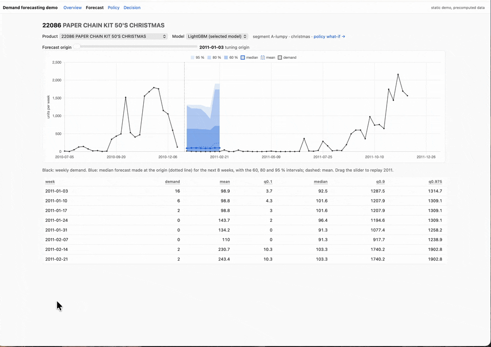
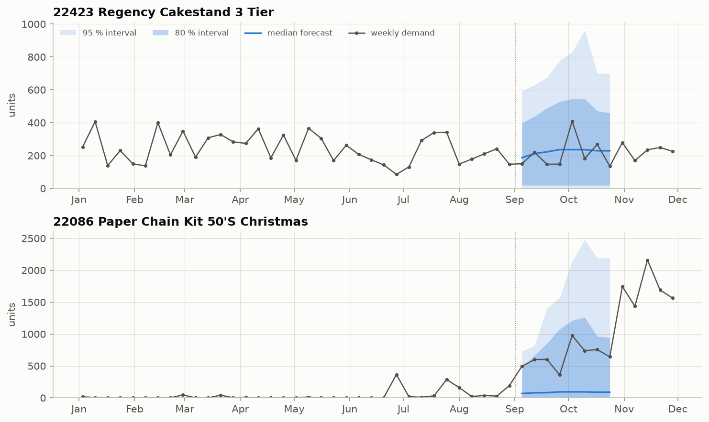
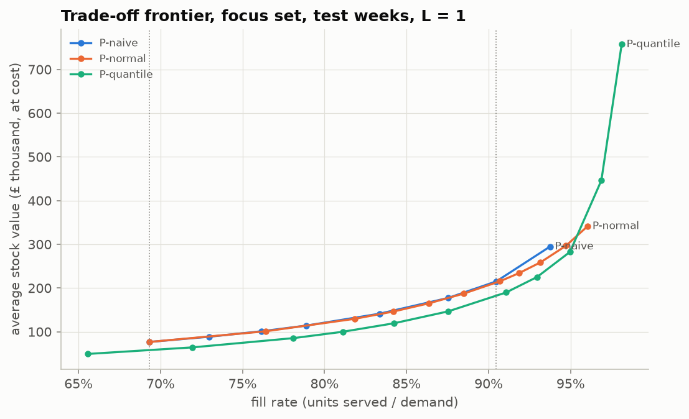
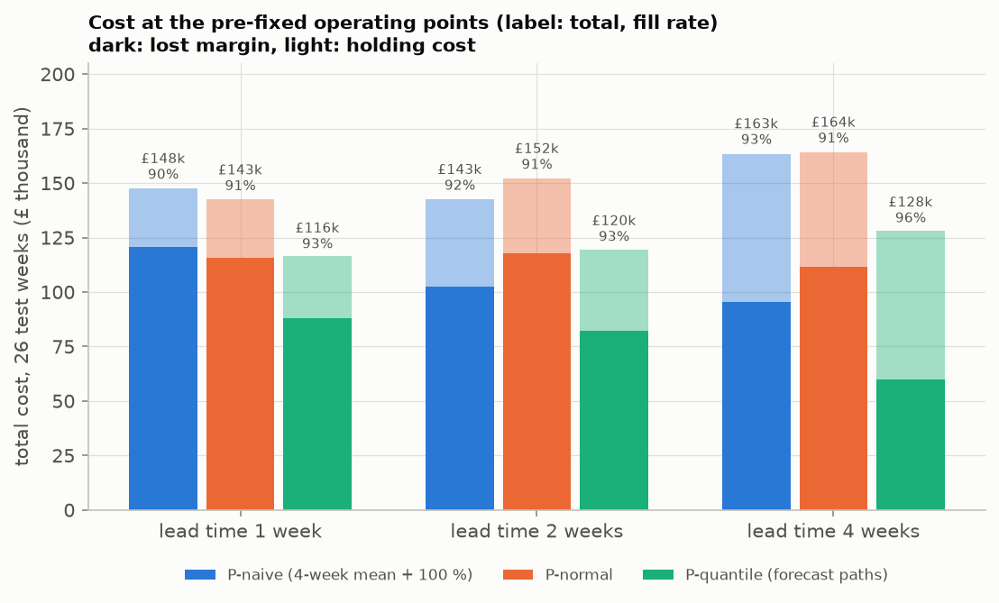

# demand-showcase

Weekly demand forecasts with quantiles for the products of a real online wholesaler (4 700 in
total, 748 in the evaluation), turned into order quantities. On the test half-year, ordering up
to a forecast quantile served more demand than the usual "four-week mean plus a buffer" rule,
at 16–22 % lower cost.

<p align="center"></p>

*The [static demo](https://alb-i.github.io/demand-showcase/demo/): replay the forecasts, move the service target and the lead
time, and see stock, fill rate and cost change.*

The technical report ([reports/report.pdf](reports/report.pdf), source
[reports/report.tex](reports/report.tex)) covers the data cleaning, the 25 forecasting methods,
the backtest, the newsvendor derivation, the simulation and the limitations. The browser tool
for runs, leaderboard, forecasts and the policy what-if is
[ml-workbench](https://github.com/alb-i/ml-workbench). A static demo (Forecast, Policy and
Decision pages for 30 products) runs at
[alb-i.github.io/demand-showcase/demo](https://alb-i.github.io/demand-showcase/demo/); its
source is in [demo/](demo/) (data: `scripts/export_static.py`, then open `demo/index.html`).

<p align="center"></p>

*Forecasts made on 5 September 2011 for the next 8 weeks: a steady seller (top) and a
Christmas product whose demand takes off in autumn (bottom). The intervals, not the median,
decide how much to order.*

## Results

**Forecasts.** 26 test origins (June–November 2011), the 748 top-revenue products, horizons 1–8
weeks. MASE and CRPS are scaled by each product's in-sample naive error (lower is better);
coverage is the share of outcomes inside the central 80 % and 95 % intervals (randomised PIT for
discrete demand). All choices were made on 22 earlier tuning origins.

| Model | MASE | CRPS | Coverage 80 % | Coverage 95 % |
|---|---|---|---|---|
| Seasonal naive (same week last year) | 1.273 | 0.611 | 75.0 % | 92.4 % |
| Naive (last week) | 0.822 | 0.448 | 80.5 % | 94.6 % |
| Moving average, 4 weeks | 0.715 | 0.385 | 81.4 % | 95.2 % |
| ETS per product + bulk orders | 0.715 | 0.355 | 82.5 % | 94.9 % |
| **Global LightGBM, one model per quantile (selected)** | **0.711** | **0.336** | 81.4 % | 94.5 % |

The selected model is 44 % better than seasonal naive in MASE (paired bootstrap 95 % CI of the
difference −0.611 to −0.512). Against the 4-week moving average the point forecast is not
better (MASE −0.004, not significant); the gain is in the quantiles (CRPS −0.049, CI −0.059 to
−0.041), and the quantiles are what the order decision uses.

**Orders.** Weekly simulation of the 748 products over the 26 test weeks with lost sales,
weekly review and lead time L. P-naive orders up to L + 1 weeks of the 4-week mean plus 100 %;
P-quantile orders up to the τ-quantile of the demand over the next L + 1 weeks, from 1 000
sample paths of the forecasts. Both operating points were fixed on the tuning weeks. Costs:
margin 40 %, holding 25 % of the unit cost per year (`configs/costs.yaml`).

| Lead time | P-naive: total cost, fill rate | P-quantile: total cost, fill rate | Cost difference (95 % CI) |
|---|---|---|---|
| 1 week | £147.7k, 90.5 % | £116.3k, 93.0 % (τ = 0.925) | −£31.4k (−£38.7k to −£24.4k), −21 % |
| 2 weeks | £142.7k, 92.0 % | £119.6k, 93.5 % (τ = 0.925) | −£23.1k, −16 % |
| 4 weeks | £163.4k, 93.0 % | £128.0k, 95.8 % (τ = 0.95) | −£35.4k, −22 % |

At the same fill rate the quantile policy needs 15–33 % less average stock. It is no free
lunch: above about 95 % fill rate its stock rises steeply, and if unsold Christmas and Easter
stock is fully written off at L = 4 the advantage over P-naive disappears (report, Section 9).

<p align="center"></p>

*Trade-off on the test weeks (L = 1): every point is one parameter value. Lower right is
better: P-quantile reaches the same fill rate with less stock.*

<p align="center"></p>

*Total cost at the operating points fixed before the test: lost margin (dark) and holding cost
(light), with the fill rate above each bar.*

## Reproduce in 3 commands

```bash
git clone https://github.com/alb-i/demand-showcase && cd demand-showcase && cp .env.example .env  # then set SHOWCASE_ROOT
micromamba create -f environment.yml && micromamba run -n demand-showcase pip install --no-deps -e .
bash scripts/reproduce.sh     # data, the selected model on all 48 origins, the policy simulation (≈ 3.5 h on 12 cores)
```

`scripts/reproduce.sh` downloads the data (checksums), builds the weekly panel, runs the
selected model on the tuning and test origins and simulates the policies on the test weeks at
the committed operating points; it writes `reports/experiments/p5_test.md` and the frontier
figure. Every run folder in `$RUNS_DIR` records its resolved configuration, git commit and data
version (a hash of the cleaning configuration and the code commit), so any single experiment below can be repeated.

## Setup (for development)

```bash
cp .env.example .env          # adjust SHOWCASE_ROOT
micromamba create -f environment.yml
micromamba run -n demand-showcase pip install --no-deps -e . -e ../ml-workbench   # a clone of github.com/alb-i/ml-workbench
micromamba run -n demand-showcase pre-commit install
micromamba run -n demand-showcase pytest -q
```

## Data pipeline

```bash
micromamba run -n demand-showcase python scripts/download_data.py   # raw/ + SHA256SUMS, read-only
micromamba run -n demand-showcase python scripts/import_raw.py      # xlsx -> processed/raw.parquet (~1 min)
micromamba run -n demand-showcase python scripts/build_panel.py     # cleaning + weekly panel (~10 s)
```

`build_panel.py [configs/cleaning-<variant>.yaml]` builds a data variant into
`$DATA_DIR/processed/variants/<variant>/`; `scripts/compare_variants.py <variant> ...` writes
`reports/variants.md`. The cleaning rules R1–R9 are documented in `configs/cleaning.yaml`; the
reconciliation of raw totals with the panel is in `reports/cleaning_report.md`.

Bulk review (R7): `scripts/review_bulk.py` serves a touch-friendly page on port 8765 to mark
each line of `reports/bulk_review.csv` keep/exclude (answers only 127.0.0.1 and
192.168.0.0/24, `--allow` to change). `build_panel.py` keeps decisions already made.

## Exploration and segments

```bash
micromamba run -n demand-showcase python scripts/segment.py      # reports/segments.{csv,md}, focus set -> configs/backtest.yaml
micromamba run -n demand-showcase python scripts/categorize.py   # product categories (configs/categories.yaml)
micromamba run -n demand-showcase python scripts/explore.py      # reports/figures/*.png, reports/eda.md
```

Segments (ABC/XYZ, Syntetos-Boylan, customer concentration) use only the weeks before the first
test origin; the focus set in `configs/backtest.yaml` is regenerated by `segment.py`.

## Backtesting

```bash
micromamba run -n demand-showcase python scripts/backtest.py configs/models/trivial.yaml [--set full]
```

Rolling origins (tuning Jan-May 2011; the test origins Jun-Nov 2011 need `--final`), horizons
1-8, quantiles and intervals in `configs/backtest.yaml`. A model sees only a `History` of the
weeks before the origin (`src/retail/backtest.py`; `tests/test_leakage.py`). Metrics
(`src/retail/metrics.py`): MASE, RMSSE, bias, scaled pinball, CRPS approximation, coverage,
unweighted and revenue weighted; paired bootstrap over series. Run folders in `$RUNS_DIR`
(meta.json, config.yaml, heartbeat, metrics.jsonl, forecasts.parquet, rows.parquet).
`scripts/compare_runs.py` writes comparison tables with bootstrap intervals.

## Experiments

Start each in a tmux window; reports go to `reports/experiments/`, runs appear in the workbench.

| # | Command | What |
|---|---|---|
| E1 | `scripts/run_e1.sh` | Naive, seasonal naive, moving averages 4/8/13 |
| E2 | `scripts/run_e2.sh` | Croston, SBA, TSB for intermittent demand |
| E2b | `scripts/run_e2b.sh` | Item and bulk demand forecast separately, then added |
| E3 | `scripts/run_e3.sh` | ETS and auto-ARIMA per series on item demand + bulk |
| E3c | `scripts/run_e3c.sh` | Product categories: category level, pooled intervals, top-down |
| E4 | `scripts/run_e4.sh`, `run_e4_grid.sh` | Global LightGBM point forecast (item + bulk or total demand), Tweedie grid |
| E5 | `scripts/run_e5.sh` | LightGBM quantile models on total demand |
| E6 | `scripts/run_e6.sh` | Rolling conformal calibration of the E5 quantiles |
| E7 | `scripts/run_e7.sh`, `run_e7b.sh` | Quantiles of 2-, 4- and 8-week demand sums from sample paths |
| E8 | — | Neural global model: a stretch goal, not run |
| E9 | `scripts/run_e9.sh` | Every model once on the 26 test origins, per-segment selection fixed beforehand (≈ 7–8 h) |
| P5 | `scripts/run_p5_tuning.sh`, `run_p5_test.sh` | Policy simulation: operating points on the tuning weeks, then the test (`configs/costs.yaml`) |

Further tools: `scripts/leaderboard.py` / `build_leaderboards.sh` (model × segment tables for the
workbench), `scripts/store_paths.py` (sample paths for the workbench what-if),
`scripts/report_figures.py` (result figures of the report), `scripts/export_static.py` (static
demo data).

## Data

Chen, D. (2012). Online Retail II [Dataset]. UCI Machine Learning Repository.
https://doi.org/10.24432/C5CG6D. Licensed under
[CC BY 4.0](https://creativecommons.org/licenses/by/4.0/). Changes: cleaned and aggregated to
weekly demand per product (`configs/cleaning.yaml`, report Section 3). The raw files are
downloaded by `scripts/download_data.py` and not redistributed here.
